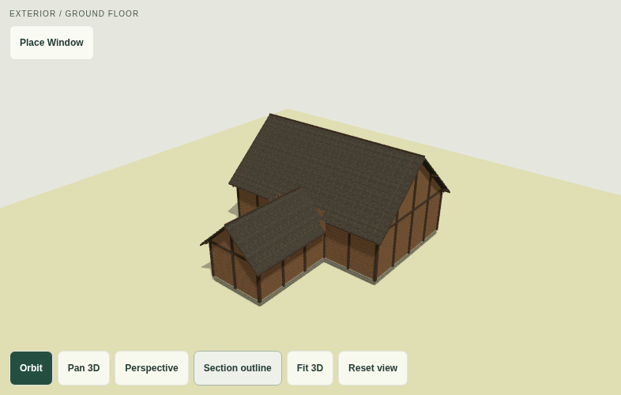
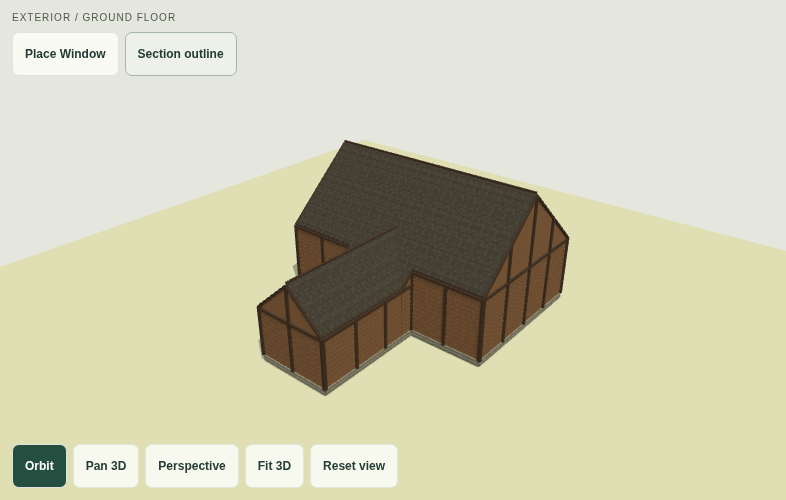
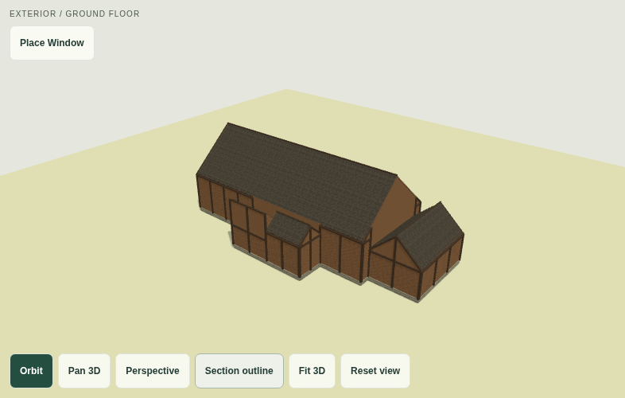
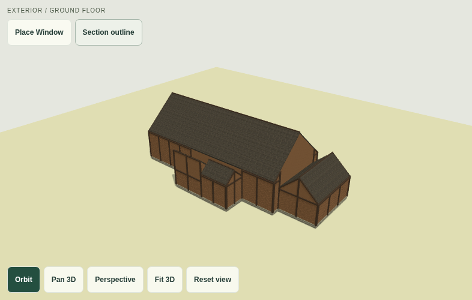
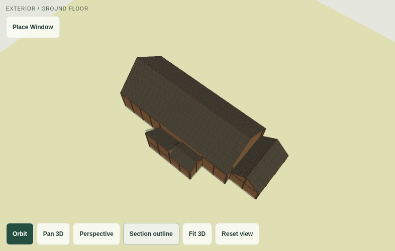
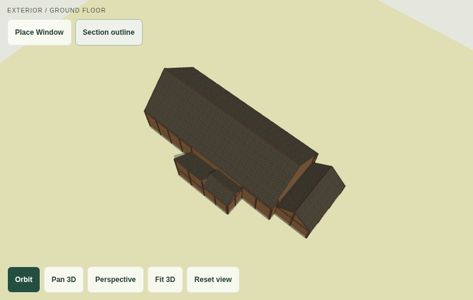
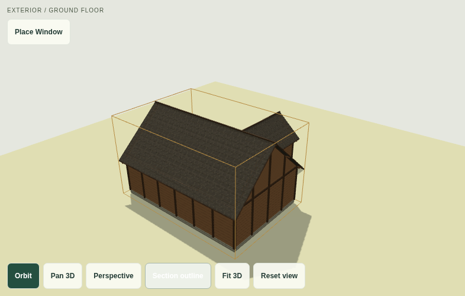
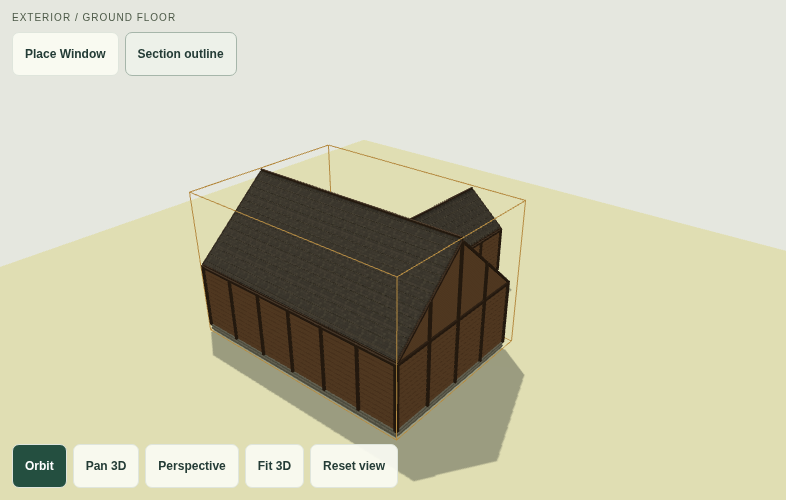

# Building Generator · BG-06A

A mobile-first architectural studio for medieval, Viking/Norse and grounded-fantasy building plans. React + TypeScript + Vite, with IndexedDB on this device and no backend, accounts, external fonts or runtime API. This repository remains independent of Hearthlands. BG-06A adds roof-only crossing gables and offset roof projections through the existing repaired roof-envelope engine. BG-05 complete architectural generation and all existing editors remain available. The 2D building model remains authoritative and BG-02B.1 mobile document scrolling is retained. Release **1.1.0**; project schema is **version 9**.

## Run, validate and deploy

Node **22.12+** (`.nvmrc`: Node 24).

```sh
npm ci
npm run dev
npm test
npm run build
npm run preview
npm run format:check
```

For a sandbox with a read-only home directory: `npm ci --cache /tmp/bg-npm-cache`. Use this checkout, without creating a separate worktree. Development uses port 5173; preview uses 4173. Access through your environment's forwarded-port UI, or run locally. Deploy **dist/** to an HTTPS static host. No server routes or environment secrets. Subdirectory build: `npm run build -- --base=/your-path/`.

Use **HTTPS for iPhone/device playtests**, or localhost on desktop: UUID creation needs secure-context Web Crypto. Keep the same origin (protocol/host/port) when reopening local projects. No deployment is performed by these commands.

## Cross-gables and roof architecture · BG-06A

The user-approved BG-05 physical iPhone Safari baseline (36/36 checks) is preserved as the starting point. BG-06A adds **Roof Architecture** in Exterior 3D. Choose a supported rectangular **Gable** section, then **Add cross-gable preview**. A roof feature adds no section, room or footprint extension: the new gable is carried by the building's existing exposed facade wall.

Choose a feature in the inspector or tap its actual sloping roof face in 3D. Adjust placement, width, pitch, relative eaves and one-sided depth. **Both facades** produces a full crossing roof; Negative/Positive produces a T-style projection, and an offset bay produces an L-style silhouette. Both-facade features span the host completely, so depth is disabled in that mode. Covering, structural framing and detail follow the host's existing architectural style.

Changes are temporary. A valid preview uses the existing interactive viewer; an invalid preview explains the problem and shows the saved roof. **Accept roof architecture** commits the complete change as one history transaction. **Cancel roof preview** restores the source exactly. Removal and Reset are previews too. Other committed changes to the selected section discard its temporary roof preview. No proposal mesh is saved.

**Rotate crossing roof frame preview** rotates the host and secondary ridge axes together, preserves feature widths and rescales local placement. If the new transverse span cannot fit a width, narrow it in preview before accepting. The secondary direction selector also validates perpendicular compatibility; parallel secondary/host ridges are unsupported. Existing section roof controls remain authoritative and reject incompatible edits rather than deleting features. Section locks apply to every accepted edit.

### Geometry and supported forms

`roofFields.ts` extracts the existing native Gable/Hip/Shed affine fields unchanged. `roofFeatures.ts` derives perpendicular secondary gable fields from persisted parameters and validates their support. `exteriorGeometry.ts` inserts these fields and their bounded domains into the existing **`roofSurface.ts` upper-envelope solver**. The solver clips native faces against secondary pitch planes at exact affine intersections; valleys are real boundaries between exposed sloping facets. The secondary ridge may be centred or offset, with a different pitch or relative elevation.

Roof-only field ownership maps back to the existing section ID and material group. It does not create fake floor-plan sections or an independent roof model. Native and secondary facets share the established top/bottom skin, ridge-cap/course generation, fascia closure and resolved-underside wall infill. The same resolved surface anchors chimneys and facade trim. Exact quarter-turn basis components prevent microscopic cells caused by trigonometric roundoff. No floating caps, duplicate roof layers or BG-04D.1 return-wall construction was introduced.

Supported limits:

- Rectangular Gable hosts, crossing ridges on either local axis; full cross, one-sided T and offset L-style projections. Existing connected L/T and multi-wing assemblies can carry a feature on any host bay whose required gable ends are exposed.
- At most **two separated bays per section / eight roof features per building**. Width 1.8–16 m with at least 0.5 m host-end margins; depth 1 m to host span; secondary pitch 20–60° at 0.1° precision; relative eaves −1 to +1 m. Bays must be separated by at least 0.4 m.
- The internal end of a one-sided projection must be fully buried at least one roof-skin thickness (120 mm) below the native host field. Every facade-reaching gable band must sit on a genuine exposed wall. Shared open-plan section joins are not roof-only gable supports.
- Unsupported: Hip/Shed or concave **hosts for new roof-only features**, parallel secondary ridges, overlapping bays, unsupported gable ends and cutoffs that would leave a raised panel. Fully buried, invisible secondary gables are also rejected. These are rejected in preview/import and structural edits; no approximation is substituted. Existing Hip/Shed roofs and the documented BG-04D.2 closed stepped/no-overhang fallbacks remain available and unchanged.
- This is bounded piecewise-planar roof composition, not a universal valley, dormer, structural-engineering or upper-floor planning system. Feature parameters may be valid while a pathological whole project exceeds the existing renderer budget; preview build checks catch that before acceptance.

### Schema v9 and preservation

Schema v9 persists only `exterior.roofFeatures` with stable IDs, local ridge axis, side, offset, width, depth, pitch and relative height. `schemas/project-v9.schema.json` documents the format. All v1–v8 imports migrate with an empty roof-feature collection; existing geometry, IDs, openings, rooms, roofs, directions, materials and other features are retained. Legacy records containing nonempty v9-only data are rejected instead of reset. Current v9 records must explicitly contain the collection.

IndexedDB and autosave remain unchanged. Raw legacy records are not rewritten during loading. Duplication rekeys roof-feature IDs along with existing references; section duplication also rekeys its roof features. Removing a host requires explicitly removing its architectural features first. Footprint edits that invalidate a bay or cutoff are rejected. BG-05 generation continues to create ordinary projects with an empty roof-feature collection; no existing design receives a cross-gable automatically.

### Tests, screenshots and iPhone retest

`roofFeatures.test.ts` adds analytic valley/ridge checks, top/bottom projected coverage, nondegenerate triangles, underside-safe walls, offset/height/pitch variations, both ridge directions, quarter-turn sections, rotation, invalid arrangements, locks, legacy migration, persistence, independent duplication and real door/window/chimney preservation. Existing BG-04D.2 regression fixtures remain in the suite. Migration assertions now expect schema v9 while retaining the original v8 golden fixture.

`tests/roof-architecture.spec.ts` tests the real preview/Cancel/Accept flow, invalid depth, atomic Undo/Redo, removal and reopening. It captures **48 images** across desktop and iPhone-sized Chromium: an 18 × 8 m full crossing hall, offset L/T projection and a generated three-extension chieftain hall, each from above/front/rear/opposite with section outlines enabled and disabled. Toggling selection must leave triangle and GPU rebuild counts unchanged. Production browser screenshots are test artifacts; a desktop set is retained in [docs/cross-gables](docs/cross-gables).

```sh
BG_E2E_PREVIEW=1 PLAYWRIGHT_CHROMIUM_EXECUTABLE_PATH=/usr/bin/chromium npm run test:e2e -- tests/roof-architecture.spec.ts --project=desktop-chromium --project=iphone-chromium
```

Validation: **283 unit/storage tests across 15 files** and **88 full production browser tests** pass. Ten desktop-inapplicable touch cases are skipped; their mobile counterparts pass. The targeted roof workflow also checks atomic host/cross-ridge rotation against the final bundle. Production build and formatting pass. Vite retains its existing advisory for the lazy Three.js chunk size.

No new dependency, shadow effect or draw-call group was added. Lazy Three.js loading, on-demand rendering, context-loss recovery, existing mesh/cell/detail budgets and GPU disposal are retained. BG-06A has **not** been playtested on a physical iPhone here; the user's 36/36 approval applies to BG-05.

Physical iPhone Safari retest (HTTPS):

1. Add a full crossing gable to an 18 × 8 m longhouse at High detail. Orbit through above/front/rear/opposite views with section outline on/off. Inspect valleys, underside, gable framing, fascia and roof courses; pinch, pan and Fit.
2. Preview a narrow one-sided roof, move it off centre, edit depth/pitch/relative eaves, and try an invalid shallow cutoff. Cancel must retain the original; Accept followed by Undo/Redo must restore complete roofs.
3. Rotate the crossing frame, correct any width warning, and test a feature on an exposed bay of a three-extension hall. Existing doors/windows/chimneys must remain intact and anchored.
4. In portrait/landscape, scroll the whole inspector page and focus numeric inputs; check for overflow or scroll traps. Save/reopen Safari, duplicate and roundtrip JSON. Confirm BG-05 generation and ordinary window dragging still work.

## Unified architectural generation · BG-05

Open a project and choose **Generate Architectural Building**. Choose a purpose and architectural preset, scale and complexity, then generate up to three complete designs. **Advanced architectural options** contains roof preferences, window density, detail budget and feature preferences. Purpose changes restore sensible defaults. Custom dimensions are metres with integer-millimetre validation; they and the requirement for a real exterior entrance are mandatory. Extension count, roof types and optional details are preferences with explicit omission warnings.

The comparison uses lightweight 2D thumbnails. Only the selected proposal occupies the existing interactive Exterior 3D viewer. Geometry/window edits are disabled during preview; orbit, perspective/orthographic projection, pan, pinch, Reset and Fit remain available. Configuration and proposals live in memory, never IndexedDB. Generate/Regenerate runs in a terminable worker, so **Cancel architectural generation** also cancels work in progress. Cancel leaves the complete original project unchanged.

**Create New Project** validates again and independently rekeys project, building, section, connection, door, window and feature IDs/references using the existing duplication path. The original project is preserved. Accepted geometry, windows, entrance and exterior settings are ordinary editable schema-v8 records, with normal autosave, JSON interchange and editing Undo/Redo. No generated rooms or partitions are added. BG-04A remains available afterwards and safely reports failure on footprints it cannot solve. There is no source-project replacement option.

Final production preview captures: [18 × 8 m Norse hall with three extensions, High detail](docs/architectural-generator/longhouse.png) · [Medieval Manor](docs/architectural-generator/manor.png). These are browser renders, not historical-accuracy or structural-engineering certification.

### Supported designs and safety

- All seven purposes: Longhouse, Cottage, Farmhouse, Workshop, Tavern/Inn, Manor and Trading Hall. Medium defaults range from a 10 × 7 m cottage to a 20 × 9 m trading hall; Small/Large scale those proportions. Custom main dimensions support the existing 4–60 m bounded generator limits. Longhouses retain the existing minimum 1.8:1 proportion requirement.
- All five existing presets: Rustic Norse, Norse Chieftain's Hall, Medieval Timber Cottage, Medieval Manor and Mixed Architectural Fantasy. Styles coordinate cladding/framing, materials and coverings with purpose-specific proportions, eaves and pitches. Norse halls retain gable dominance when permitted. Supporting wings are lower, rather than independently randomised roof masses. Lean-tos use a shallow 12° pitch and high edges face their actual attachment in local coordinates, with lower eaves where the supported minimum allows.
- Rectangular main structures and up to five connected rectangular support sections, creating L/T and multi-wing compositions. Simple is compact, Organic varies offsets and proportions, Grand favours larger/multiple-direction wings without increasing the requested count. Source rectangles deliberately avoid unsupported concave single-section roof generation.
- BG-04B remains the footprint solver. Each search has at most 32 composition attempts / 1,600 attachment trials. If necessary, the requested extension preference is reduced by a bounded sequence of searches (at most six total); the result states the reduction. No arbitrary footprint repair or bounding-box area estimates are used.
- Existing runtime validators place a real exterior entrance, then bounded, evenly spaced exposed-wall window bays (at most 160 attempts). Windows reserve full frames/shutters, exclude doors and joins, and respect roof clearances. Storage, porches and narrow wings do not receive generated windows. Window density is a target, not a guaranteed count.
- Optional main-hall chimney, paired gable ornament and entrance canopy use existing validators. Unsafe/unsupported features are omitted with the reason, never decorative fake openings or detached features. Unused roof preferences are disclosed. Generated entrances do not imply building-code compliance or an interior circulation plan.
- Every complete candidate passes `validateProject` and the repaired `buildExterior` pipeline, including finite facet/mesh and whole-footprint roof coverage checks. Existing `roofSurface.ts` pitch intersections, skin closure, mobile geometry limits and documented closed stepped/no-overhang fallbacks remain authoritative. No second roof engine or universal valley solver was added.
- At most three candidates are enriched and scored for inherited composition quality, entrance validity, useful window provision and omitted preferences. Variants differ in attachment geometry, heights and/or supported roof composition. A fixed footprint can still have three height/roof silhouettes. Complete temporary records and door/window placement reproduce from the same canonical settings and seed; only accepting a new project assigns fresh IDs and timestamps.

**Limitations:** bounded heuristic search, not exhaustive architectural optimisation; only rectangular source sections in this workflow; complex joins may use disclosed closed steps or omitted overhang. Optional features/windows are not guaranteed. No interior layout, upper floors, stairs, furnishings, dormers or export/conversion is generated. There is no physical iPhone performance certification from Chromium emulation.

### Validation and iPhone playtest

`architecturalGenerator.test.ts` covers every purpose and style, deterministic complete data, meaningful variations, complexity, each roof family with High detail and top/bottom skin coverage, validated/omitted features, independent acceptance, persistence/JSON/duplication and subsequent BG-04A layout generation. `architecture-generator.spec.ts` exercises real workers, comparison, cancellation, source preservation, independent creation/reopen, edit availability and horizontal overflow on desktop and iPhone-sized Chromium; it captures generated longhouse/manor preview screenshots as test artifacts. All earlier roof, editor, storage and migration regressions remain in the suite. No schema migration is needed: schema v8 and v1–v7 import compatibility are preserved.

Validation for BG-05: **271 unit/storage tests pass** across 14 files, including all prior geometry/migration tests. The full production desktop + iPhone-sized Chromium suite passes **84 tests**, with **10 desktop-inapplicable touch skips** (mobile counterparts pass). The four affected architectural workflow cases are also rerun against the final production bundle. `npm run build` and `npm run format:check` pass. Vite retains the existing lazy Three.js chunk-size advisory; no new package was added. Physical iPhone Safari/WebKit performance is not verified here.

Physical iPhone Safari checklist (HTTPS):

1. Generate an 18 × 8 m Norse hall with three extensions and High detail. Compare A/B/C; orbit above and around each roof, pinch, pan and Fit; inspect entrances, windows and supported trim/features.
2. Generate a Medieval Manor and a cottage. Check their silhouettes/materials, omission warnings and roof coverage, including the opposite side. Toggle roof preferences and regenerate; cancel while busy.
3. Swipe through the expanded configuration/Inspector in portrait and landscape. The whole page must scroll, with no horizontal overflow; gestures outside the viewer must not orbit or edit.
4. Create a new project, verify the original remains, then edit windows/roof direction and Undo/Redo. Reopen Safari and roundtrip JSON. Run BG-04A afterwards on a supported rectangular design; a safe no-solution result for a complex wing is acceptable.

## Roof intersections and floating geometry · BG-04D.2

This release keeps **schema v8** and all saved footprints, section settings, openings, rooms and feature identities. It changes derived roof geometry only, with necessary facade/feature reanchoring. No Three.js meshes or new persistent fields are stored, no dependency was added, and no later-phase work was included in that repair.

The BG-04D.1 diagnosis was incomplete. The additional causes were:

1. Roofs stopped at source-section boundaries even when a perpendicular pitch should continue into its neighbour. Large vertical return panels substituted for the missing intersection, producing the fin/notch appearance.
2. Wall and gable prisms reached the **roof top**, so their top triangles occupied the same plane as shingles. This caused wall-coloured triangular patches and coplanar overlap; closing a skin edge could not repair it.
3. Exterior overhang ownership was chosen using a grid-cell centre's nearest section. Aperture-driven grid changes could change that assignment. Trim also evaluated the higher roof at discontinuous endpoints, allowing a diagonal bar to bridge the wrong profile.
4. Chimney flashing used a flat-bottom prism that could invert on steep pitches. Corner-only shaft anchoring could miss a ridge inside its footprint and leave the cap below the roof.

**Repair:** `roofSurface.ts` builds deterministic support domains and an exact upper envelope of the existing pitch planes. A rectangular roof may project across a **directly attached rectangular neighbour**, bounded by its attachment span and the neighbour's midline. A projection is accepted only when every artificial interior cutoff is below the neighbour's native roof. Genuine exterior edges may rise with the resolved roof and receive matching infill. Convex affine clipping resolves the visible surfaces and valley lines; coincident planes have one owner, with native section material preferred. There is one exposed roof surface per domain, not stacked decorative roofs.

Native footprints, exposed-edge eave strips and corner domains replace nearest-cell roof ownership. Domain boundaries enter the coordinate-compression grid, so window tessellation cannot move roof seams. Wall/gable tops stop at the **resolved roof underside**, without duplicate top caps. Stored eaves settings continue to locate the finished roof plane; the derived wall meets the 120 mm skin beneath it. Roof top/bottom skins, ridge caps, courses, fascia, facade trim and rafter anchors follow the resulting surface. Degenerate triangles are discarded. Trim uses each interval's own profile at a step. Chimneys follow the resolved roof's full flashing region, including interior ridge points, with a thin parallel flashing skin instead of an inverted wedge; saved feature records remain unchanged.

**Closed fallbacks:** raised roofs, concave source sections, incompatible cutoff profiles and excessive intersection complexity retain deliberately bounded stepped transitions. Roof-skin caps and the intervening wall band are separate non-overlapping ranges, with consistent facing and source materials. Steps remain on real attachment lines. If an outside eave transition would need unsupported infill or intersect the foundation, overhang is omitted with an Inspector warning; stored overhang is retained. Concave sections keep their documented clipped-pitch simplification. This is **not a universal valley, dormer or structural roof-engineering solver**.

The gold **BoxHelper is a selection annotation**, not roof/wall geometry. **Section outline** toggles that annotation independently; selected/unselected captures assert unchanged triangles and GPU rebuild counts. Existing camera actions, window dragging, safe-area layout and portrait document scrolling are retained.

### Before/after evidence

Baseline captures use BG-04D.1 roof construction with only the annotation toggle added for comparison. The referenced user image was not attached to this turn; these are reproducible 18 × 8 m / three-extension and perpendicular-wing fixtures, using the same Reset view/camera procedure.

| Fixture                           | Before                                                        | After                                                       |
| --------------------------------- | ------------------------------------------------------------- | ----------------------------------------------------------- |
| Perpendicular wing                |               |               |
| Main longhouse + three extensions |     |     |
| Above the longhouse               |   |   |
| Wing with selection annotation    |  |  |

`tests/roof-evidence.spec.ts` generates **96 current comparison screenshots**: six fixtures × above/front/rear/opposite views × selected/unselected × desktop/mobile. They are attached to Playwright results under `test-results/roof-evidence-*/after-*.png`. Fixtures include longhouse/three extensions, perpendicular wing, L/T compositions, equal/unequal eaves, Gable/Hip and both ridge directions in High detail. Regenerate with:

```sh
npm run build
BG_E2E_PREVIEW=1 PLAYWRIGHT_CHROMIUM_EXECUTABLE_PATH=/usr/bin/chromium npm run test:e2e -- tests/roof-evidence.spec.ts --project=desktop-chromium --project=iphone-chromium
```

`roofSurface.test.ts` adds a 36-configuration matrix covering pitch/overhang, Gable/Hip/Shed, both axes, eave heights and Standard/High detail. Checks include actual top **and underside** mesh coverage, overlapping facets, coincident-plane ownership, nondegenerate triangles, no wall above the roof underside, steps supported by real contacts, aperture-independent seams, chimney anchoring and unchanged JSON. Earlier area/direction/migration tests remain; the old requirement to emit a wall at every source join was replaced with testing actual resolved seams, since that wall was part of the defect.

**BG-04D.2 validation:** 249 unit/storage tests passed; 80 production desktop/mobile Chromium browser checks passed with 10 desktop-inapplicable native-touch skips (mobile counterparts passed). Build and formatting passed. The 96 selected/unselected captures completed. Physical iPhone Safari remains unverified; the lazy Three.js chunk retains Vite’s standard >500 kB advisory (about 143 kB gzip).

Changed files: `src/roofSurface.ts`, `src/exteriorGeometry.ts`, `src/ExteriorViewer.tsx`; roof geometry tests/fixtures and screenshot suite; release labels/package files; this README and committed evidence images. `exteriorScene.ts` was inspected: its BoxHelper, material normals, on-demand rendering, caching and disposal are retained. Triangle/cell/detail budgets remain bounded, with a 40,000-facet intersection guard and a native-domain fallback. Physical iPhone Safari performance still requires the device check below.

### BG-04D.2 iPhone Safari retest

1. Open the 18 × 8 m hall with three extensions, then L/T and perpendicular-wing fixtures. Inspect above, front, rear and opposite views with Section outline on/off; verify solid junctions and no wall-coloured roof patches.
2. Change ridge axes, Gable/Hip/Shed, eaves, pitch and overhang at Standard/High detail. Check valleys or the explicit closed-step/overhang fallback, aligned trim, and chimneys above the roof.
3. Orbit/pinch/pan/Fit, place and drag windows, scroll the portrait Inspector, focus numeric fields and rotate landscape/back. Verify no geometry changes from camera/page gestures or horizontal overflow.
4. Undo/Redo, save/reopen, export/import and duplicate. Confirm footprints, rooms, doors, windows, styles and feature IDs/anchors survive unchanged. Test on physical Safari; Chromium emulation is not device certification.

## Roof repair, direction and visual windows · BG-04D.1

**Roof defect and repair.** The old roof top facets covered the tested footprint domains, but unequal-height junction infill joined only the **top edges** of neighbouring roofs. The exposed lower part of each **120 mm roof skin** was left without a return; shallow steps and intersecting pitch planes could expose those cut edges. Perimeter fascia also had inward winding. Junction returns now span the complete cut profiles, split at every pitch-plane/height crossing, with consistent facing toward the lower roof. Fascia winds outward. Matching-height seams need no extra panel. No floating slabs, arbitrary caps or duplicate coplanar infill were added; ridge caps, courses, trim and overhang fallback remain tied to the same roof surfaces.

Multi-section roofs still use the visible, documented **closed stepped/clerestory fallback**, rather than a universal valley solver. Concave roof planes remain clipped to their true footprint. Overhangs still fall back to the actual footprint when a clean offset is unsupported; rafter ends follow that choice. The Inspector explains these limits. Repair does not change footprints, walls, windows, doors or room topology.

**Roof direction:** the Exterior Inspector exposes **Ridge along local X/Y** for Gable/Hip, and **High edge at local +X / -X / +Y / -Y** for Shed. Roof pitch and eaves height stay unchanged. Section rotation and the shared building frame transform these local settings normally. Gable infill, ornaments, caps, shingles/courses and roof-linked chimneys follow the new planes; incompatible ornaments/clearances reject the edit. Locks, Undo/Redo, save/reopen and JSON roundtrips apply normally.

Legacy roofs use `ridgeAxis: "Auto"` and `shedHighEdge: "Auto"`, retaining exactly the old long-axis/default shed slopes. A direction becomes explicit when selected. Explicit Hip orientation preserves transverse pitch and steepens the end hips only as needed to leave a ridge at least 20% of the selected-axis span. Consequently end-hip pitch can differ from the Inspector's transverse pitch. Window/canopy clearance uses the highest derived slope conservatively, so an incompatible direction is rejected without deleting features; no structural roof-engineering accuracy is claimed.

**Direct window workflow:** press **Place Window** in the viewport, tap an exposed wall, then drag the preview horizontally/vertically. The wall and source section are raycast automatically. Green/red preview and clearance text update live, using the current grid snap or Free setting. **Confirm placement** accepts one transaction; **Cancel placement** leaves saved geometry unchanged. A lightweight overlay previews windows without rebuilding the full detailed building on every pointer move. The real aperture is cut on acceptance.

Tap an existing window to select it, choose **Move Window**, then drag it on its host or onto another exposed wall. A completed valid drag commits once; an invalid drag retains the original and leaves the red preview for correction/cancellation. Normal **Orbit** never repositions windows. A second finger cancels the pending one-finger change, restores its prior preview, and hands both pointers to OrbitControls for pinch/pan. Only the viewer captures those gestures; page scrolling and coordinates after document scrolling retain BG-02B.1 behavior. Leaving the mode or editing/undoing the underlying building discards temporary window previews.

The Inspector retains width/height/sill/offset/style controls. **Use precision placement** offers numeric placement without a wall tap. Both workflows use the same `prepareBuilding` / `validateExterior` path, including source/destination locks, door/window/frame/shutter/corner/roof clearances and explicit wall references. Windows never enter room topology or the circulation graph. Internal open-plan joins are ineligible hosts.

Schema **v8** adds only `ridgeAxis` and `shedHighEdge` to each section's exterior settings. v1–v7 migrate at read time with Auto directions, retaining every existing identity, dimension, material, roof setting, window/feature, opening, room, note, timestamp and lock. Unsupported explicit direction data in a legacy record is rejected instead of reset. Temporary tools/previews are not persisted and Three.js meshes remain derived. The IndexedDB database/version is unchanged.

**Regression evidence:** `roofJunction.test.ts` checks actual projected facet area, full skin returns across equal/unequal Gable/Hip/Shed combinations, outward fascia, local directions, ornaments, history and migration. `windowPlacement.test.ts` checks snapped/free/grab-offset transforms, validated moves and populated v7 migration. `tests/exterior-repair.spec.ts` covers wall tap/drag/cancel, cross-wall moves, invalid previews, normal Orbit, native multi-touch handoff, direction persistence and **48 screenshots** (six fixtures × four angles × desktop/mobile). Screenshots are attached to the Playwright result and written under `test-results/exterior-repair-closed-*/junction-*-angle-*.png`; rerun that test to regenerate them. Fixtures include the 18 × 8 m three-extension longhouse, L/T outlines, perpendicular wings, equal eaves and mixed Gable/Hip/Shed roofs with High detail.

**BG-04D.1 verification:** 235 unit/storage tests and 78 production desktop/mobile Chromium tests passed; 10 desktop-inapplicable native-touch cases skipped (mobile counterparts passed). TypeScript/Vite build and formatting passed. The isolated lazy Three.js chunk retains Vite’s standard >500 kB advisory (about 143 kB gzip). Physical iPhone Safari remains a device playtest requirement.

## Architectural detailing · BG-04D

In **Exterior 3D**, select a section by tapping its surface or using **Exterior section**. The **Architectural style**, **Detail level** and **Roof covering** controls update only that section, with Undo/Redo and autosave. Existing Norse/Medieval/Mixed preferences remain available and preserve dimensions. No windows or chimneys are automatically added to migrated projects.

| Style                       | Visible architectural treatment                                                                              |
| --------------------------- | ------------------------------------------------------------------------------------------------------------ |
| Rustic Norse                | Horizontal timber boarding, substantial posts, dark wood shingles, modest stone plinth                       |
| Norse Chieftain's Hall      | Close-set vertical cladding, heavier and more frequent posts, layered stone courses, contrasting timber trim |
| Medieval Timber Cottage     | Light plaster infill, diagonal bracing and mid-rails, warmer clay-tile covering when selected                |
| Medieval Manor              | Denser framing and upper braces, deeper layered plinth, dark slate and restrained pale plaster               |
| Mixed Architectural Fantasy | Timber wainscot below plaster infill, bracing and warm timber roof treatment                                 |

The style selector chooses an appropriate covering; **Wood shingles / Slate / Clay tiles** can then be selected independently. Styles do not alter footprints, roof heights, room plans or floor-count metadata. All facade boards, posts, braces, layered stone courses, entrance surrounds and rafter ends follow the **real merged exterior segments**, never a bounding-box facade or internal open-plan join. Framing bays avoid physical door/window openings. Roofs retain exact pitch-plane forms and the documented closed stepped-junction fallback below. Ridge/hip caps, fascia/verges and rafter ends follow actual slopes and eaves. High detail adds thin merged course geometry on clipped roof planes, rather than separate shingle meshes.

**Windows:** choose **Place window**, an actual external wall, exact along-wall position, width, height and sill elevation. A valid candidate previews in 3D and in a small elevation diagram without changing saved data. Invalid placements show their reason and cannot be confirmed. **Confirm window** is one history transaction; **Cancel window** discards it. Select a window by tapping its aperture/frame in 3D or using **Selected window**, then edit exact fields or remove it with confirmation. Choose **Timber shuttered**, **Medieval glazed** or **Narrow slit**, with explicit glazing/shutter toggles. Frames and optional shutters/glazing are rendered around a real full-thickness wall aperture. Width describes the rough wall aperture; the frame occupies its edges.

Windows support rectangular and concave exteriors and exposed parts of attached sections. Limits: **0.4–2.4 m width**, **0.3–2.2 m height**, **sill ≥0.5 m**, at least **0.25 m below eaves** (a larger conservative clearance is required for steep roofs and projecting frames/shutters), **0.1 m from wall endpoints/corners and other openings**, including the complete frame/shutter bay. The whole horizontal bay is reserved; stacked windows are deliberately unsupported. A bay crossing a partition junction is conservatively refused by the shared host validator. Up to 32 windows per section, with a combined runtime limit of 128 doors/windows. Windows are stored separately from doors and never affect logical room boundaries, areas or circulation. Compatible structural edits preserve/reanchor windows; invalid edits are rejected without deletion.

**Architectural features** are explicit, section-linked and limited to rectangular sections:

- **Chimney:** at most two per section, Stone or Brick, editable local X/Y and **0.5–2 m height above the highest intersected roof corner**. The 0.6 m shaft has sloped flashing, a cap and a dark top recess. It requires 0.8 m perimeter clearance, 1 m separation from other chimneys and safe roof/junction support. Gable, Hip and Shed are supported. This is exterior chimney geometry, **not an interior flue**.
- **Gable ornament:** one paired, restrained timber finial set, supported only on a rectangular Gable roof with exposed gable ends. Changing to an incompatible roof is rejected until the ornament is explicitly removed.
- **Entrance canopy:** a small timber-supported lean-to over an existing exterior entrance on the selected section; requires eaves ≥3.1 m, endpoint clearance, clearance below the roof overhang and clear exterior space. It follows its door reference and prevents that door's silent removal. No new functional doorway is invented.

Remove individual features with confirmation, or **Reset architectural details** to explicitly remove this section's windows/features as one undoable change. **Reset section to style defaults** retains explicit windows/features and refuses incompatible defaults. Locks protect all architectural settings. Duplicating a project rekeys all window/feature identities and canopy door references; copying a section independently rekeys its details and must still pass attachment validation. A canopy-bearing section cannot be copied independently of its entrance; use whole-project duplication or explicitly remove the canopy first.

**Performance:** each surface category is a merged buffer per section with shared materials/textures, not one mesh per board/shingle. Low omits fine detail; Standard adds cladding, trim and rafter ends; High adds at most 3,000 roof-course fragments across the building. Fine-detail buffers hide beyond three building-diagonal camera distances (adjusted for orthographic zoom), without removing architecture or apertures. The existing pixel ratio, shadow/cell/triangle limits, lazy WebGL loading, render-on-demand, offscreen pause, context-loss recovery and disposal remain in place. Native iPhone performance has not been measured here.

## Architectural exterior and interactive 3D · BG-04C

Choose **Exterior 3D**, the third Studio mode. The on-demand Three.js chunk loads only when this mode is opened; no 3D framework is used. Walls, roofs and facade details derive from the same section IDs, exact merged footprint, wall inset, positions, rotations and exterior openings used by the 2D editor. No meshes or manually synchronised copy of the building are saved. Returning to 2D retains its camera and authoritative geometry.

Drag to **Orbit**, choose **Pan 3D**, or use two fingers to zoom/pan. **Perspective/Orthographic**, **Fit 3D** and **Reset view** are available. Arrow keys pan when the viewer has focus. Tap a rendered surface to select its source section, or use the Exterior Inspector's section list. Selection outlines identify the section; locks disable its architecture fields. Camera gestures do not edit project geometry. Heights/pitch/overhang/material edits and reset are ordinary Undo/Redo transactions with normal autosave.

The Exterior Inspector edits per-section **eaves height (2.4–12 m)**, **Gable/Hip/Shed roof**, **pitch (10–65°, 0.1° precision)**, **overhang (0–1 m)** and **Norse/Medieval/Mixed material preset**. It reports actual derived ridge/high-edge height from generated roof vertices, including overhangs. **Reset section to style defaults** resets only the selected unlocked section. Settings survive compatible footprint edits; changing material leaves dimensions/heights alone until reset. The project architecture preference remains separate from these per-section appearance choices.

Defaults: Norse main eaves **3.8 m**, Medieval/Mixed **3.6 m**, supporting wings **3.1 m**, Storage **2.8 m**, Porch **2.4 m** with a Shed roof, Tower Footprint **6.5 m**. Norse pitch/overhang is **42° / 0.45 m**, Medieval **38° / 0.35 m**, Mixed **40° / 0.35 m**. Towers are taller ground-level exteriors; `floorCount` remains metadata and does not create upper-floor plans.

**Visible architecture:** Norse has timber cladding, dark shingle treatment, posts, beams, pronounced gables and a stone foundation band. Medieval adds contrasting plaster, timber braces and muted slate-like roofing. Mixed blends warm wall surfaces and timber with brown roofing. Textures are small deterministic procedural canvases, without external image downloads. Facade posts/braces are decorative; there are no invented windows or entrance apertures. Existing hinged exterior doors render open leaves with their stored hinge/swing direction; passages render gaps only. Existing widths/anchors are retained. As no opening height exists in the 2D schema, exterior apertures use a documented **2.1 m height** (door leaf 2.0 m). Interior partitions/doors are preserved in data and are not shown as exterior openings; this is not a dollhouse cutaway.

### Roof support and honest fallbacks

- **One rectangular section:** real piecewise planar gable, hip or shed faces; actual ridges/eaves, perimeter overhangs, **0.12 m roof skin**, fascia/edge timber and wall-thickness gable/high-end infill. Roof heights use pitch over the short section axis; Hip slopes are the minimum of four planes. These are geometric forms, not engineered roof structures.
- **Connected rectangular sections, including L/T-style compositions:** section roof domains remain disjoint. Differing heights close with vertical **step/clerestory panels**; shared joins get no internal overhang or ground-to-eaves separating wall. This is an explicit stable simplified junction, **not an accurate valley intersection**. The Inspector always states this fallback for multi-section buildings.
- **Concave L/T/U/Cross/Irregular sections:** pitch planes are clipped to the actual footprint, with closed edges/infill. The Inspector labels this as a simplified concave roof solution. It can look less traditional than a purpose-designed segmented valley roof; no advanced intersections are claimed.
- Perimeter overhangs offset actual exterior edges. Unequal collinear eaves, tight notches, reversed/crossing offsets or insufficient outline coverage use a **no-overhang fallback for the assembly**, with an explicit warning; stored values stay intact. Roof domains cover the authoritative footprint and do not overlap or float. No silhouette/bounding-box extrusion replaces exterior wall geometry.

`exteriorGeometry.ts` is deterministic and independent of Three.js. Exact coordinate compression cuts the merged wall band and actual opening gaps; roof facets come from affine-plane clipping, with closed perimeter/junction faces. Model coordinates remain **X/Y horizontal, Z vertical in millimetres**; only `exteriorScene.ts` converts to Three **X/Z horizontal, Y up in metres**. The shared frame applies whole-building rotation/placement. Individual meshes cache by stable section ID and derived geometry/material fingerprint; only changed groups rebuild. Shared boundaries may necessarily affect neighbouring groups.

For mobile, pixel ratio is capped at **1.5**, shadows at **1024²**, roof/wall compression at **40,000 exact cells**, and derived geometry at **250,000 triangles**. Complex records beyond that budget show a useful fallback instead of harming saved data. Rendering is on demand (no idle animation loop), pauses offscreen/when the document is hidden, and disposes buffers, materials, textures, controls, shadows and the WebGL context on exit/retry. Context loss or unavailable WebGL2 gives an explicit safe fallback with Retry; 2D editing/autosave remain independent. The lazy Three.js chunk is approximately **140 kB gzip**; Vite's standard >500 kB uncompressed-chunk advisory is expected for that isolated chunk.

Portrait Studio remains one scrolling page. Only the viewer viewport captures touch gestures; Inspector controls scroll the document, moving the canvas/toolbar naturally offscreen. Safe-area padding, stable viewport height, landscape panels and no horizontal overflow are retained. Physical iPhone Safari performance still requires the playtest below; Chromium/SwiftShader tests are not device certification.

## Procedural building footprints · BG-04B

In **Footprint** mode, choose **Generate Building**. Configure Norse/Medieval/Mixed architecture, Longhouse/Cottage/Farmhouse/Workshop/Tavern/Inn/Manor/Trading Hall purpose, Simple/Organic/Grand complexity, main length/width, **0–5 desired extensions**, optional preferred section types, main starting outline and seed. Defaults are a Norse longhouse, 18 × 8 m, Simple, one supporting extension. Use **Generate footprints** to repeat a seed or **Regenerate buildings** to change it.

**Mandatory constraints** are the exact integer-mm main dimensions, requested extension count, explicit outline (unless Auto), valid connected geometry and clear spans. **Preferences** guide purpose proportions, architecture, complexity, extension types and composition scoring. A longhouse requires length ≥ 1.8 × width; incompatible inputs explain the constraint instead of rewriting dimensions. Other departures from preferred proportions are reported. Preferred types that are absent are listed; no requested extension is silently omitted.

The generator offers up to **three geometrically different proposals A/B/C** on the existing SVG canvas, with **Compare buildings** thumbnails, actual exterior/usable interior areas, outer extents, section names/types/dimensions, coherence scores and explanations. Geometry edits are disabled during previews; pan, zoom, Fit and pinch remain available. Collapsing the Inspector retains proposals. Previews and temporary configuration are never persisted. **Cancel building generation** terminates its worker and returns to the original building without changing project data.

**Create New Project** is the only acceptance action. Enter a project name; the selected candidate is runtime-validated and every project/building/section/connection ID is rekeyed before saving. The original project, including locked sections, partitions, room labels/notes and doors, is preserved. Pending manual edits must save successfully before switching. Storage failures keep the preview available with a clear retry message. Current-building replacement is deliberately not offered. New sections are unlocked and fully editable using existing attachment, dimension, move, resize, rotation, lock and Undo/Redo tools; validation remains authoritative.

Supported compositions include elongated rectangular main halls, cottages with porches, farmhouses with residential/support wings, workshops with storage, tavern/trading halls, secondary halls, square tower footprints and multi-wing manors. All **Rectangle, L, T, U, Cross and Irregular** main presets are available where their wall inset and clear limbs remain valid. Auto uses simpler rectangles for Simple/Longhouse and a broader outline pool for Organic/Grand; Norse favours rectangular hall forms. Complexity changes outline pools, extension sizes and offsets; it does not change the requested count. Extensions use rectangular templates, possibly offset along a shared edge; tower footprints are square and remain ground-level geometry only. Different purposes use different main roles and supporting-section profiles.

The local worker performs at most **32 composition attempts**, **1,600 attachment trials total** and **36 trials per extension in each attempt**. Candidate sizes/offsets use 100 mm increments; exact entered main dimensions preserve millimetres. Generator-specific limits are **4–60 m main dimensions**, **0.2 m exterior walls**, at least **2.2 m shared edges** and **1.8 m clear limbs/necks**. Supporting extensions cannot dominate the main footprint. These limits do not restrict the existing manual editor. Zero extensions with a fixed outline and dimensions have only one physical geometry; fewer than three results are reported honestly. Bounded failure does not prove that all possible compositions are infeasible.

`attachmentPreview`, `prepareBuilding`, exact orthogonal union/inset, clear-space and project validators reject overlaps, holes, self-touching boundaries, disconnected/corner-only joins, invalid offsets, narrow necks and unsupported orientation relationships. Areas come from actual merged polygons, never bounding boxes. Open-plan shared edges have one continuous exterior wall boundary. Ranking considers purpose proportions, compactness, requested asymmetry, extension scale and represented preferences; proposals must differ by at least 0.4 m of exterior boundary, not merely labels or IDs.

No rooms, partitions, doors or roofs are generated by this operation. **Interior Planning / BG-04A Generate Layout** can be used afterwards on supported generated footprints. Complex shapes can return the room solver's normal safe failure; building geometry is never altered to manufacture a solution. The existing section/frame/connection models and IndexedDB database are reused; BG-04C migrates these records to schema v6, preserving v1–v5 import compatibility, JSON export and duplication. Accepted buildings store ordinary section/frame/connection records only, with normal autosave. No architectural/structural code compliance is claimed.

## Automatic room layouts · BG-04A

In **Interior Planning**, choose **Generate Layout**. The starter requests Main Hall, Kitchen, Bedroom and Storage. Configure **2–5 rooms** with quantities, minimum/preferred areas and Required/Preferred priority, then choose Compact, Balanced or Open and a seed. The panel compares total required minimum area with actual usable interior area before generation. Preferred areas are scoring targets, not hard limits; Required minimums are mandatory. Preferred rooms that cannot fit are explicitly reported.

**Generate** repeats the same inputs and seed; **Regenerate** changes the seed. Up to three geometrically different valid proposals appear as **A/B/C**. Select a proposal on the existing canvas or use **Compare** for miniature plans. Each reports exact net assigned/unassigned area, separate threshold area, room sizes, score and validated entrance access. Camera controls remain available, with geometry editing disabled during preview. Generation runs in a cancellable local Web Worker; no external API is used.

**Preview and Cancel never change the project or autosave its candidate.** Accept validates the complete candidate against the live structure and commits the entire interior in one Undo transaction. Before replacing existing partitions, room records/labels/notes or interior doors, a confirmation lists what will be replaced. Existing exterior entrances are preserved exactly; incompatible placements are rejected. Undo restores all previous walls, rooms and openings. Accepted layouts use ordinary editable records and work with save/reopen, export/import and duplication. Temporary settings/previews are not stored; no schema migration is added.

The bounded seeded solver uses exact clear-space geometry and existing partition, opening, swing and circulation validators. It supports rectangles and some L-shaped/attached-wing interiors that can be recursively divided by full orthogonal cuts. Tests cover those examples; arbitrary concave shapes are **not guaranteed**. It never substitutes bounding-box areas or reports failed candidates as solutions. Larger/required rooms are allocated first; scoring considers preferred size, entrance room, adjacency and circulation. A valid proposal must give every generated room a real entrance path and unobstructed door swings. No room or access connection is invented.

Search limits: **1,800 cut evaluations**, **2,400 door-slot evaluations**, a beam of **16** candidates per cut depth, at most **4 partitions**, and at most **32 clear-boundary vertices**. Cuts use 50 mm increments, **100 mm partitions** and at least **1.8 m clear spans**. Doors use existing validated 900 mm hinged or 1,200 mm passage openings. These generator limits do not restrict subsequent manual editing. Search failure explains constraints and preserves the source; it does not prove every possible arrangement infeasible. Fewer than three valid distinct solutions are reported honestly. Different seeds provide alternatives where feasible, without guaranteeing a solution for every seed.

Any locked architectural section blocks whole-building generation; partial protected-section solving and selective regeneration are outside BG-04A. Existing exterior entrances are kept, while replacing a populated plan is an explicit all-interior operation. All generated regions receive room labels (unassigned area is normally zero); partition thresholds remain separate passage area under the BG-03B convention below. There is no real-world code or structural-engineering certification.

## Doors, openings and circulation · BG-03B

In **Interior Planning**, use **Place Door** and tap a real partition or exterior wall. The Doors & Openings Inspector shows a translucent placement with valid/invalid feedback. Adjust its centre distance from the host's start and width, then **Confirm opening** or **Cancel opening**. No preview changes saved geometry. Hinged doors default to **0.9 m**, open passages to **1.2 m**; the host determines Interior Door or Exterior Entrance. Passage openings may also open to outside.

- Tap a saved opening or use **Select door/opening**. Drag its centre along its wall, or a jamb handle to resize symmetrically, then confirm the preview. Exact numeric edits on a saved opening commit independently; they never resize its wall. Deletion asks for confirmation. All accepted operations support Undo/Redo. Grid/Free affects canvas placement/dragging; exact inputs preserve integer-mm precision. Whole-building translation/rotation preserves anchors and door orientation.
- Each opening has a stable ID, type, source-wall reference and integer-mm centre offset/width. Partition references use stable partition IDs; external references use source section ID plus edge index. Source edges must coincide with a real merged exterior boundary. BG-02B open-plan section joins have no wall and cannot host doors.
- Physical gaps are cut from the wall bands with SVG luminance masks, including exterior walls in Footprint mode. Room-separating partition geometry stays logically complete: inserting/removing doors never merges regions, rekeys rooms or changes their names/types/notes. Threshold surfaces are shown separately.
- A hinged leaf opens 90° about its chosen jamb, with a true radius-width swing arc. **Left** means the wall-start jamb; **Right** the wall-end jamb. **Side A** is left of the directed host, **Side B** right. **Flip Hinge** and **Reverse Swing** update the geometry. Passages have no leaf, hinge or arc. A warning appears when the swept quarter-disc intersects physical wall geometry; this includes exterior walls and excludes confirmed opening gaps. It is advisory and does not prevent intentionally obstructed layouts.
- Widths are **0.4–3 m**. Leave **0.1 m** from host endpoints, merged exterior corners, other openings and partition junctions. The full aperture must adjoin clear space on both partition sides, or exactly one interior side for an exterior opening. Invalid overlaps, junction cuts, unsupported hosts and protrusions are rejected. Maximum **128 openings**. Relevant section locks protect opening placement, edits and deletion.
- Moving a host carries its opening. Resizing a wall start adjusts its stored offset to keep the opening's longitudinal location fixed. Reversing/replacing a host direction requires explicit opening removal/relocation first. Host shortening, removal and footprint/extension edits revalidate all openings and reject invalid edits without detaching or deleting them.

**Area convention:** thresholds through partitions are **separate passage area**, excluded from logical net room areas. Net rooms + remaining physical partitions + interior thresholds = the unchanged usable-interior baseline. Exterior thresholds reduce exterior wall footprint only and are never added to that baseline. For the centred BG-03A partition, rooms remain **43.70 + 43.70 = 87.40 m²**. A 0.9 m door through its 0.1 m thickness contributes **0.09 m²** threshold and leaves **0.67 m²** partition: **87.40 + 0.09 + 0.67 = 88.16 m²**. A 0.9 m entrance through 0.2 m exterior walls removes **0.18 m²** exterior wall footprint without changing 88.16 m². Calculations are exact; displayed areas are rounded.

`src/circulation.ts` builds an access graph from validated apertures and the actual full-width clear regions on each wall side. Exterior openings seed reachability; interior doors/passages add region edges, including multi-hop routes. Open-plan regions are already continuous. The Inspector reports **Accessible** or **No entrance path**, including the selected room; disconnected regions receive warning outlines. Intentionally inaccessible rooms remain valid and savable. This is potential ground-floor traversal through placed doors, without a closed/locked door state; it is not real-world code, accessibility or fire-escape certification. No connections are invented.

## Manual interior planning · BG-03A

Switch between **Footprint** and **Interior Planning**. Footprint retains the complete section editor; Interior Planning shows the actual merged clear interior, including continuous open-plan joins. Floor counts remain metadata; only the ground floor has a plan.

- **Draw Wall**: tap a start, then an end. The preview is constrained to horizontal/vertical building-local axes. Boundary and existing partition endpoint/centreline snapping takes priority within 10 screen pixels, then the selected grid; Free preserves millimetres without grid rounding. Snap off disables magnets. Use **Cancel wall start** or Escape to cancel. Default thickness is **0.1 m**; set New partition thickness before drawing.
- **Select Wall**: tap the physical wall or its 44px hit region; drag its body to move, or either endpoint to resize along its axis. The partition dropdown resolves junction ambiguity. Exact start X/Y, direction, length and thickness inputs ignore grid rounding. Deletion requires confirmation. Each accepted edit is one undo transaction.
- Corners and T-junctions may meet at centreline endpoints; an end can also butt against a wall face. Junction footprints are unioned once. Protrusions, positive-area parallel overlaps, unsupported four-way crossings, zero/short walls and impossible clear geometry are rejected with an explanation. Wall thickness is physical geometry, not a display stroke.
- **Select Room**: tap a clear region or choose it in the Inspector. Assign a name, one of ten room types and notes. Text fields commit on blur; wall geometry controls boundaries. A named or typed region counts as assigned; other clear space is visibly unassigned. Areas exclude the unioned partition footprint, including clean joints and floating/unfinished walls.
- A dangling or floating partition does not create additional rooms. Clear connected regions may be concave or contain a partition island; even-odd boundary rings and exact cell area account for these. Displayed outer extents are labelled as extents and are never used as net area.
- When topology remains unchanged, region IDs and labels survive wall movement through unique boundary-side/topological matching, with an unambiguous positive-area overlap fallback. Merges/splits retain ambiguous names, types and notes under **Retained room labels**, with a visible notice in both modes. Copy a label to a selected region; discarding a retained label requires confirmation. Undo restores all prior assignments.
- Existing interiors validate against every structural footprint/extension edit. Invalid edits are rejected, preserving the previous plan. Valid edits that merge/split clear space retain affected labels. Whole-building X/Y placement translates sections and their frame equally; rotation changes only the frame. Both preserve local partition coordinates. Section locks prevent adding, moving or deleting partitions that overlap the locked section; whole-building translation also respects locks.

Acceptance example: a **12 × 8 m** rectangle with **0.2 m** exterior walls has **88.16 m²** usable interior. A vertical partition from **(6, 0.2) m** to **(6, 7.8) m**, thickness **0.1 m**, occupies **0.76 m²**, leaving **two 43.70 m² regions**, **87.40 m²** total clear area. Assigned + unassigned + partition area reconciles exactly with usable interior; the UI rounds displayed areas to two decimals.

`src/interior.ts` performs deterministic coordinate compression at actual boundary/wall-face coordinates, unions wall occupancy, flood-fills clear regions and traces oriented exterior/hole rings. It uses no sampled raster, bounding-box room areas or runtime geometry dependency. Integer-mm centrelines and thickness are stored; odd thicknesses have exact half-mm derived faces. Geometry/topology remains separate from SVG rendering and camera transforms.

Planning limits: **64 partitions**, **512 active/retained room records**, at least **0.1 m** wall length and **0.1 m** clear passages/spans with partitions, **0.01–1 m** partition thickness, at most **1,000,000 exact compressed cells**. Valid older footprints with narrower clear space remain loadable with an empty plan. These are editing limits, not structural-engineering guarantees.

## Architectural sections and attachments

- Keep the main footprint and add up to **11 extensions**, for **12 sections total**. Types: Residential Wing, Workshop, Storage, Porch, Hall Extension, Tower Footprint and Custom. Every section has an ID, name, type, lock flag, exact dimensions and placement. Tower footprints are only ground-level shapes; floors remain metadata.
- Use **Architectural Sections** to select a section. The panel is on the desktop's left, and inside the mobile inspector. A second selected-section dropdown offers exact selection on small screens. Locked sections use a different tint/dashed outline and have disabled geometry/metadata controls.
- **Add Section / Attach Extension** opens a translucent preview without changing the saved project. Choose an external combined-footprint edge, template, type, shape, dimensions and along-edge offset. A selected exterior section edge is honoured; otherwise the first compatible exterior segment is suggested without changing the chosen dimensions. Internal-only selected edges cannot be attachment points.
- Templates: **Small side wing, Rear extension, Corner wing, Workshop attachment, Entrance porch, Square tower footprint, Custom dimensions**. They are editable starting geometry, not finished buildings. All six BG-02A footprint shapes are available for new extensions.
- The candidate's first polygon edge aligns to the external edge with opposing filled sides. Partial edge sharing, different lengths and negative/positive along-edge offsets are allowed. A join needs at least **0.1 m** of shared boundary. The blue edge is the selected attachment segment; green/red preview and validation text explain whether it can be accepted. Fit includes the preview, including a valid-shaped candidate with an invalid connection.
- **Accept extension** commits one undo transaction. **Cancel attachment** discards it. Pinch, pan, zoom and Fit continue to work during preview; existing geometry cannot be dragged while placement is active.
- Select and drag a section's interior to move it; drag its vertices/edges/corners to edit, or use the inspector's exact metre inputs. Every preview/edit validates the **whole assembly**, not just the selected shape. Invalid edits return to the committed geometry and show the reason. Valid edits may slide along a shared edge or alter its extent, but may not disconnect, overlap, create a hole or invalidate the wall inset.
- Rename and change the selected section type under Building details. **Duplicate section** deep-copies the source geometry and opens placement for a new attached copy; choose its external edge/offset before accepting. Copies are initially unlocked. **Remove section** asks for confirmation, refuses locked/main sections, and refuses removal of a connector if it strands another section. Undo restores accepted changes.
- Locked sections are never repositioned, resized, renamed or removed by other edits. Changing the common wall thickness is an explicit all-section operation and is rejected while a locked section would change. Whole-building rotation intentionally changes the assembly's frame, without changing any section or connection records.
- **Building rotation** rotates the entire assembly about its frame origin at any angle without coordinate rounding or broken attachments. Joined section orientations must be quarter-turn compatible in that frame. Exact XYZ position inputs describe the shared assembly axes; the inspector states the origin. Use whole-building rotation for arbitrary angles after attachment.

Example: a **6 × 4 m** wing sharing an edge with a **12 × 8 m** building yields **120 m²** exterior area, and **110.56 m²** clear interior at 0.2 m walls for the default attachment. The merged wall path removes the shared internal wall. Connections are **open-plan only**; no automatic separating partition, doorway or door generation is claimed. Manually drawn partitions can span these joins.

## Preserved footprint editor

Rectangle, L-shape, T-shape, U-shape, Cross and Irregular are genuine polygon outlines. The default rectangle is 12 × 8 m with 0.2 m walls: **96 m² exterior / 88.16 m² interior**. The default L removes a 4 × 3 m corner: **84 / 76.16 m²**. Presets replace the selected outline; Undo restores it, and assembly validation rejects invalid replacements.

Master coordinates use integer millimetres. Exact numeric metre inputs accept three decimal places and ignore grid snapping. Polygon length/width are validated outer extents; changing them scales that local axis with explicit millimetre rounding. Areas always use actual boundary polygons. Irregular starts with an eight-vertex stepped ring; insertion/removal/freehand drawing are not included, but imported sections can contain 4–64 vertices.

Vertex edits adjust their two neighbours to keep orthogonal edges. Edge drags move perpendicular to themselves; exact edge length fixes its start and shifts its end/following perpendicular edge. Selection highlights vertices/edges. An adjoining section's actual interior wins over transparent handle hit regions; boundary ambiguity retains the selected section, and the section list/dropdown is always available. Handles are at least 44 CSS pixels.

Independent display-grid and snap toggles; **0.25 / 0.5 / 1 / 2 m** presets and **Free**. Vertex/edge snapping uses local section axes; section movement uses shared assembly axes. Free retains 1 mm precision. Display grid thins at distant zoom and reports its visible spacing. Grid changes never change geometry.

In mobile portrait (up to 650 CSS pixels), the Studio scrolls as one document: swiping the Inspector moves the toolbar and canvas offscreen, and scrolling back reveals them. Inspector contents and the architectural section list expand to their full height, with no nested scroll areas. Collapse/expand is retained. The canvas has a stable `clamp(320px, 55svh, 520px)` editing height (420px fallback), so Safari's dynamic address bar does not resize it during scrolling. Safe-area padding is retained; there are no sticky workspace elements. Desktop and landscape retain their viewport workspace with a scrolling side Inspector.

Canvas-specific touch capture stays on the SVG; Inspector inputs use ordinary page scrolling. Pointer mapping reads the current canvas screen bounds on each event, including after document scrolling. Edit/Pan tools, anchored zoom, wheel/pinch and Fit are retained. Pointer previews commit once on release; cancellation or a second finger rolls back the preview before pinch starts. A remaining finger cannot accidentally resume editing. Undo history retains the last 100 transactions in the active session.

Keyboard: **V** Edit, **H** Pan, **⌘/Ctrl Z** Undo, **⌘/Ctrl Shift Z / Ctrl Y** Redo, **⌘/Ctrl S** Save. Focus canvas and use arrows to move the selected unlocked section by its snap step (0.1 m for Free/snap-off; Shift ×10). Enter commits exact inputs; Escape restores a numeric field or cancels/deselects a canvas gesture.

## Deterministic geometry and limits

`orthogonalUnion.ts` uses **coordinate compression and a vertical sweep**. Slabs are delimited by actual integer edge coordinates; they are exact cells, not a sampled raster. Occupied intervals form the union. Positive-area overlaps are detected, internal edges are removed, the exterior boundary is traced, and collinear segments are simplified. Multiple boundary loops or branching/touching contours are rejected, so holes/disconnections are never silently repaired. Results are deterministic across input order/winding.

Each section uses a simple orthogonal ring before rotation, with 4–64 vertices, alternating horizontal/vertical edges and at least 0.1 m per edge. Section/combined extents are limited to 0.5–500 m, source local vertices to ±500 m, and stored section/frame positions to ±10,000 m. The merged ring supports up to 768 vertices. Sections must share one ground-level Z value and common wall thickness. Z and floor counts remain metadata, not structural levels.

Shoelace area computes exact exterior area. Clear area and the continuous rendered external wall band use the **validated mitered inward offset of the merged boundary**, not sums of section interiors or bounding-box estimates. The offset must remain one positive connected ring, not reverse edges, cross boundaries or intrude within the wall clearance. Too-thick walls, tiny jogs, collapsing necks, split interiors, overlapping interiors, holes, corner-only contacts and detached sections are rejected. Common exterior walls must be at least 0.01 m. No invalid measurement is replaced by an estimated value.

## Schema v8 and migration

The existing `building-generator-bg01` IndexedDB database, database version 1, and `projects` object store are retained. `schemaVersion: 8` retains:

- `building.mainSectionId` and up to twelve `sections`.
- Section `name`, `type`, `locked`, with the original rectangle or polygon geometry fields.
- `building.frame`: `origin` (integer XY), `axis`, `rotation`, `mode`.
- Explicit connections: stable `id`, endpoint section IDs and edge indices, shared integer segment `start`/`end`, `mode: "open-plan"`.

Schema v4 introduced `building.interior: { partitions, rooms }`. Each partition has a stable ID, integer-mm endpoints `a`/`b` and integer-mm thickness. Room records have a stable ID, a derived geometric `regionKey` (or null for retained labels), name, type and notes. Geometric region keys contain coordinates, not identity references.

Schema v5 adds `building.openings`, each with `id`, `type`, a partition/exterior `host`, `offset` and `width`; hinged records also require `hinge` and `swing`. Passages omit hinge/swing. Runtime validation checks references, aperture geometry, clearances and unique IDs.

Schema v6 adds required `section.exterior: { wallHeight, roofPitch, roofStyle, overhang, material }`. Height and overhang are integer mm; pitch is degrees to 0.1°. Versions 1–5 receive type/architecture defaults without modifying any existing field or identity. Version 6 must contain valid settings; missing/invalid records are rejected instead of reset. Duplicate section/project operations deep-copy settings and continue rekeying all identity references. Derived triangles/textures/cameras are never persisted.

Schema v7 extends `section.exterior` with `stylePreset`, `detailLevel`, `covering`, `windows` and `features`. Window records carry stable IDs, source-wall edge index, integer-mm offset/width/height/sill, style, shutters and glazing. Feature records carry stable IDs, kind, integer-mm section-local placement/height, finish and an optional canopy `doorId`. The section itself supplies the shared stable section reference. v1–v6 migration adds default style/detail/covering and **empty** window/feature collections, retaining all original heights, roof settings, locks, IDs and interior data. Invalid v7 records are rejected, never replaced with defaults. Legacy v6 records containing non-empty unsupported feature collections are rejected rather than silently discarded.

Pure read-time migration accepts schema **1, 2, 3, 4, 5, 6, 7 and 8**. Versions 1–4 receive an empty opening collection. Populated BG-03A interiors retain every partition/room ID, coordinate and label. Versions 1–3 receive an empty interior plan without modifying their original geometry or metadata. Valid BG-01/BG-02A sections retain **all original IDs, names, architecture, geometry, position, rotation, wall/floor measurements and timestamps**. New section metadata defaults to Main building / Custom / unlocked. Legacy rectangles remain rectangles; polygons retain their original vertices and ordering. `frame.mode: "legacy"` preserves the single section's world transform and precision; its initial origin/axis mirror the section without rewriting geometry.

The first accepted attachment enters **assembly** mode. Positions then share integer assembly axes anchored at that preserved origin; section quarter turns are relative to the frame axis. The frame's additional `rotation` is applied only for rendering/world transforms, so attachments stay exact. An assembly retains its frame even after its last extension is removed; remaining sections cannot jump, including moved/locked sections. Earlier-phase single-section projects retain their original arbitrary orientation and world-placement controls until attachment.

Connections are derived from real shared section edges and persisted explicitly. Edits recompute segments and retain connection IDs for the same endpoint-edge pair. Imports require connection records to match the geometry exactly, rather than silently repairing stale relationships. Project duplication and conflicting-ID imports rekey **every section, connection, partition, room and opening identity** and remap section/partition host references, with independent geometry arrays. Exports use v8; v1–v7 imports remain supported, but older app versions cannot open v8 exports. Room geometric keys remain valid after identity rekeying.

Library reads never overwrite old records. A successfully validated legacy record is written as v8 on the next edit/save/exit. Invalid/unsupported records stay untouched and are reported; loading failures never create fallback projects. The legacy JSON schemas remain alongside `schemas/project-v8.schema.json`. Runtime validation adds connectivity, lock-transition, geometry and cross-field checks beyond structural JSON Schema.

## BG-04C implementation map

| Files                                                                                       | Responsibility                                                                                                                 |
| ------------------------------------------------------------------------------------------- | ------------------------------------------------------------------------------------------------------------------------------ |
| `src/exteriorSettings.ts`, `src/model.ts`, `src/attachments.ts`, `src/buildingGenerator.ts` | Section settings/defaults, strict v6 validation, lossless migrations and new-section defaults                                  |
| `src/exteriorGeometry.ts`                                                                   | Pure continuous wall/opening geometry, sloping roofs, closed stepped junctions and facade framing                              |
| `src/exteriorScene.ts`, `src/ExteriorViewer.tsx`, `src/ExteriorBoundary.tsx`                | Lazy Three.js viewer, engine conversion, camera/picking, incremental GPU cache and failure/resource handling                   |
| `src/ExteriorInspector.tsx`, `src/Studio.tsx`, `src/App.tsx`, `src/styles.css`              | Three Studio modes, architectural controls/history and responsive integration                                                  |
| `schemas/project-v6.schema.json`, `tests/fixtures/bg01-project-v6.json`                     | New schema and migration expectation; older files remain intact                                                                |
| `src/exterior.test.ts`, `tests/exterior.spec.ts`, prior regression tests                    | Roofs, openings, exact areas, migrations, independent copies, controls, WebGL failure, idle pause and touch/scroll regressions |
| `playwright.config.ts`, `package.json`, `package-lock.json`, `README.md`                    | Headless software-WebGL tests, Three.js/type dependency, BG-04C / 0.8.0 and documentation                                      |

## BG-04B implementation map

| Files                                                                        | Responsibility                                                                                                              |
| ---------------------------------------------------------------------------- | --------------------------------------------------------------------------------------------------------------------------- |
| `src/buildingGenerator.ts`                                                   | Bounded seeded composition search, scoring, exact validation, independent project creation                                  |
| `src/buildingWorker.ts`                                                      | Responsive cancellable worker and progress/results                                                                          |
| `src/BuildingGeneratorPanel.tsx`                                             | Configuration, comparison thumbnails, warnings and Create New Project                                                       |
| `src/Studio.tsx`, `src/Editor.tsx`, `src/App.tsx`, `src/styles.css`          | Read-only footprint previews, Fit, save-before-switch and existing studio/library integration                               |
| `src/buildingGenerator.test.ts`, `tests/buildings.spec.ts`                   | Purposes, all main outlines with attachments, deterministic geometry, areas, safe creation/persistence and mobile workflows |
| `tests/footprints.spec.ts`, `package.json`, `package-lock.json`, `README.md` | BG-04B / 0.7.0 version and documentation                                                                                    |

BG-04B required no new dependency or schema migration. Its BG-04A modules remain in use:

### BG-04A implementation map

| Files                                                                                       | Responsibility                                                                                     |
| ------------------------------------------------------------------------------------------- | -------------------------------------------------------------------------------------------------- |
| `src/layoutGenerator.ts`                                                                    | Seeded bounded candidate generation, assignment, scoring, doors, validation and acceptance checks  |
| `src/layoutWorker.ts`                                                                       | Cancellable worker execution and progress/result messages                                          |
| `src/GeneratorPanel.tsx`                                                                    | Configuration, comparison previews, metrics and explicit replacement confirmation                  |
| `src/Studio.tsx`, `src/Editor.tsx`, `src/styles.css`                                        | Read-only canvas preview, single-transaction acceptance, touch controls and responsive integration |
| `src/layoutGenerator.test.ts`, `tests/layouts.spec.ts`, `tests/interiors.spec.ts`           | Determinism, geometry, circulation, safety, roundtrips and desktop/mobile workflows                |
| `src/App.tsx`, `tests/footprints.spec.ts`, `package.json`, `package-lock.json`, `README.md` | BG-04A / 0.6.0 version and documentation                                                           |

BG-04A reused existing interior topology, opening/access validators, camera transforms, history and IndexedDB modules without a schema change in that phase.

## Automated checks

```sh
npx playwright install chromium webkit
npm run test:e2e
```

Linux may require Playwright system dependencies (`npx playwright install-deps`, with administrator permission). Browser installation needs the official CDN. With preinstalled Chromium:

```sh
PLAYWRIGHT_CHROMIUM_EXECUTABLE_PATH=/usr/bin/chromium npm run test:e2e -- --project=desktop-chromium --project=iphone-chromium
```

After building, prefix the browser command with **`BG_E2E_PREVIEW=1`** to validate the production bundle through preview. Stop other servers on port 5173 first. For WebKit when available: `npm run test:e2e -- --project=iphone-webkit`.

Tests retain BG-01 through BG-04B workflows and cover physical wall gaps, exact opening/threshold areas, stable room identities, entrance/multi-hop reachability, passages, hinge/swing geometry, obstruction warnings, invalid hosts/overlaps/junctions, lock protection, host resizing/movement, undo/redo, v1–v5 import/export, independent host references, persistence and native multi-touch cancellation. Mobile scrolling and pointer-to-world regressions remain enabled. BG-04A adds seeded 2–5-room generation, concave/wing fixtures, exact area reconciliation, validated door access and swings, Preferred omission, bounded failure, lock restrictions, non-destructive previews/cancellation, replacement confirmation, whole-plan undo/redo and generated-plan persistence/import/editing tests. BG-04B adds all seven purposes, all six main outlines with and without attachments, maximum extension count, exact combined areas, seeded geometric variation, square tower preferences, safe new-project creation, source-plan/lock preservation, generated-section edits and persistence, cancellation, storage failure/retry, portrait scrolling and native pinch coverage. BG-04C adds exact wall-band/opening volumes, sloping roof forms, closed concave/joined fallbacks, style differences, v1–v6 lossless migrations, independent architectural settings, lazy WebGL loading, camera gestures, settings Undo/Redo, save/reopen/JSON roundtrips, mesh caching, idle/offscreen pause, WebGL/context-loss recovery and portrait resize/scroll checks.

BG-04D verification: **219 unit/storage tests passed**, **71 production desktop/mobile Chromium browser tests passed**, with **9 desktop-inapplicable native-touch skips** (their mobile counterparts passed). TypeScript/Vite production build and formatting checks pass. Unit tests cover v1–v7 migration/roundtrips, independent feature identities, exact window aperture volumes, door/window collisions, structural/lock safety, supported flashed roofs, canopy references, deterministic style geometry and detail budgets. Browser checks exercise placement previews/cancellation, exact editing, history, save/reopen, rendered style captures and bounded draw calls, alongside every earlier regression.

WebKit is not installed in this machine (the official browser CDN was blocked during BG-01 setup). Chromium mobile emulation/native Chromium touch dispatch does **not** verify physical iPhone Safari; run the playtest below on a device.

## Known limitations and data safety

- Strict edge-to-edge, **open-plan** joins only; all positive-area overlaps are rejected. Attachment aligns the candidate's first local edge; change the external segment, offset or shape to choose another placement. No generated partitioned joins or doors, holes in the exterior footprint, split exterior wall insets, slanted local edges, vertex insertion/removal or freehand drawing. Interior rooms use orthogonal partitions, placed manually or accepted from the bounded generator.
- One main building cannot be removed. Section count max 12; combined dimensions max 500 m. No automatic movement of neighbours to “fix” an invalid edit. A duplicated section must be placed on a valid external edge before acceptance.
- Common walls/elevation must agree. A locked section blocks any operation that would modify its stored data. Whole-building rotation is an intentional frame operation and does not unlock/change section records. Undo/redo restores previously committed lock/geometry states.
- IndexedDB autosaves after 400 ms idle; Saving/Saved/Save Error, retry/export backup and flush-before-leave are retained. Wait for **Saved**. Private browsing, clearing site data, storage pressure, origin changes or OS termination can lose local/unsaved data. Export JSON backups. Persistent storage is requested but not guaranteed.
- Same-project multi-tab editing has no conflict resolution (last save wins). History/view/grid preferences are session-only. No service worker/offline installation.
- BG-04D remains ground-floor planning with an architectural exterior. Hinged doors are single leaves with a 90° swing. No selective regeneration, stairs, editable upper-floor interiors, furnishing, advanced roof valleys/dormers, structural engineering, game conversion or downloadable 3D export. No next-phase features are implemented.

## BG-04D files

- `exteriorSettings.ts`, `exteriorValidation.ts`, `model.ts`, `assembly.ts`, `attachments.ts`, `openingBuilding.ts`, `interiorBuilding.ts`, `openings.ts`: schema v7, style/feature settings, anchor/clearance validation, structural safety and identity remapping.
- `exteriorGeometry.ts`, `exteriorScene.ts`: true aperture cuts, style-specific merged facade/roof detail, feature meshes, procedural materials, distance simplification and window picking.
- `ExteriorDetails.tsx`, `ExteriorInspector.tsx`, `ExteriorViewer.tsx`, `Studio.tsx`, `styles.css`: touch-friendly preview/edit controls, shared selection and mobile-safe integration.
- `App.tsx`, `buildingGenerator.ts`, package files: BG-04D / 0.9.0 / schema v7 identifiers.
- `schemas/project-v7.schema.json`, new v7 fixture, `exteriorDetails.test.ts`, `exterior.spec.ts` and existing schema-expectation tests: migration, geometry, persistence, browser regressions. Legacy schemas/fixtures remain unchanged.

## Short iPhone Safari 3D playtest

1. At the same HTTPS origin, reopen a legacy building and a named interior plan; export backups. Open Exterior 3D: inspect the pitched roof, gable infill, cladding, timber details, stone band and an existing entrance's real gap/open leaf. No interior door should appear on an exterior wall.
2. Orbit through 360°, pan, pinch, toggle projection and use Fit/Reset. Tap several wings and verify selection matches the 2D section IDs. Change eaves, pitch, Gable/Hip/Shed, overhang and material; Undo/Redo and reset defaults. Check locked sections remain protected.
3. Generate a BG-04B Norse longhouse with three extensions; inspect sensible heights and closed step junctions from all sides. Try an L-shaped and multi-wing plan; confirm fallback notices and no floating roof pieces. Do not interpret these simplified junctions as engineered valleys.
4. In portrait, scroll Inspector controls until the viewer leaves and returns with the document. Focus numeric fields with the keyboard open, vary Safari's address bar and rotate landscape/back. Check stable geometry/camera targeting, touch isolation, safe areas and no horizontal/nested scroll trap.
5. Return to 2D, move/rotate/resize a section, reopen 3D and verify updated architecture with retained settings and intact rooms/doors. Wait for Saved, reopen Safari, export/import and duplicate; compare settings, labels, IDs and geometry.
6. Background/restore Safari and switch 3D/2D repeatedly. Check idle heat/frame activity and resource stability on a device. If context loss or unavailable WebGL occurs, verify the fallback/Retry and continued 2D editing/autosave without lost data.

7. Switch all five detail presets on a longhouse/cottage/manor; compare boarding, framing, stone courses and coverings. Try Low/Standard/High at near/far zoom, then inspect an 18 × 8 m longhouse with three extensions for smoothness, attached details and closed junctions.
8. Place a window on an exposed wall, preview/cancel, confirm, tap to select, edit width/height/sill and toggle shutters/glazing. Confirm the wall has a real aperture; test rejected door/window/corner overlaps and unsafe footprint edits. Rooms and access status must remain unchanged.
9. Add/move a Stone/Brick chimney on each supported roof, add/remove a gable ornament and canopy over a real entrance. Try incompatible settings, locks, reset, Undo/Redo, save/reopen and JSON duplication; ensure no window, roof or interior data disappears silently.

## BG-04D.1 implementation files

- `exteriorGeometry.ts`, `exteriorSettings.ts`, `exteriorValidation.ts`, `ExteriorInspector.tsx`: roof returns/winding, local directions, dependent geometry/feature validation and controls.
- `windowPlacement.ts`, `useWindowPlacement.ts`, `exteriorWindowGestures.ts`, `exteriorScene.ts`, `ExteriorViewer.tsx`, `ExteriorDetails.tsx`, `Studio.tsx`, `styles.css`: exact placement transactions, ephemeral previews, exposed-wall raycasting, single-pointer drag and two-pointer handoff.
- `model.ts`, `buildingGenerator.ts`, `App.tsx`, package files, schema v8 and fixture: migrations, current identifiers and validation; legacy files remain intact.
- New geometry/placement/browser suites and current-schema expectations in previous tests preserve all earlier regression coverage.

## BG-04D.1 iPhone Safari retest

1. Open an 18 × 8 m three-extension Norse longhouse, L/T footprints, perpendicular wings and mixed/equal-height roofs. Orbit all sides and inspect the undersides of stepped joins, fascia and gables at Low and High detail. Expect closed steps, not engineered valleys.
2. Change ridge X/Y and all four Shed directions; check aligned trim/ornaments/chimneys, locks, Undo/Redo and save/reopen. Whole-building rotation must preserve local direction.
3. Place a window by tapping, drag horizontally/vertically, confirm/cancel, then select → Move Window and drag onto another exposed wall. Check red invalid corner/overlap/roof/locked previews, one-step Undo and intact room/access data.
4. While editing a window, add a second finger and pinch/pan: no window change may commit. Return to Orbit and ensure dragging a selected window only orbits. Scroll the portrait document, focus numeric inputs, vary Safari's address bar and rotate landscape/back; check coordinates, touch isolation and no overflow/scroll trap.
5. Save/reopen, export/import/duplicate and background Safari; verify windows and directions persist and WebGL fallback/Retry preserves the project. Physical Safari performance requires this device check; Chromium emulation is not device certification.
